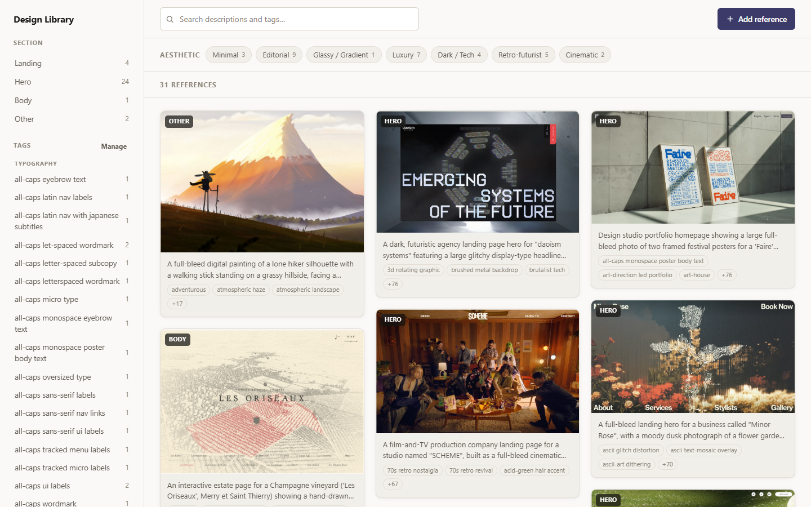
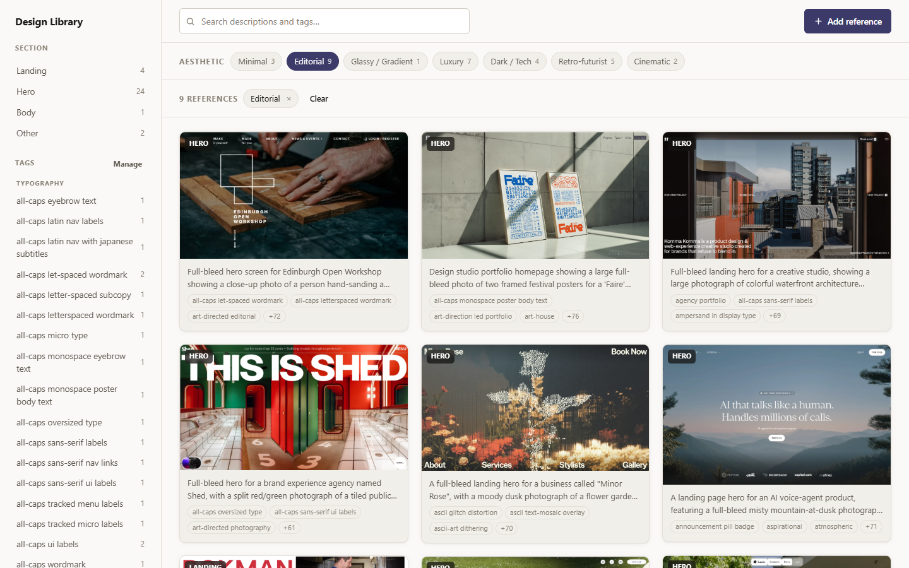
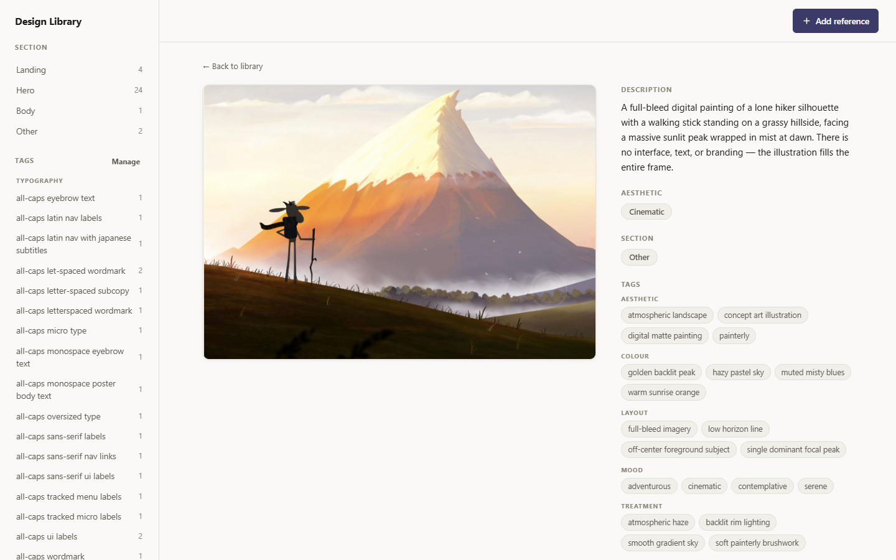
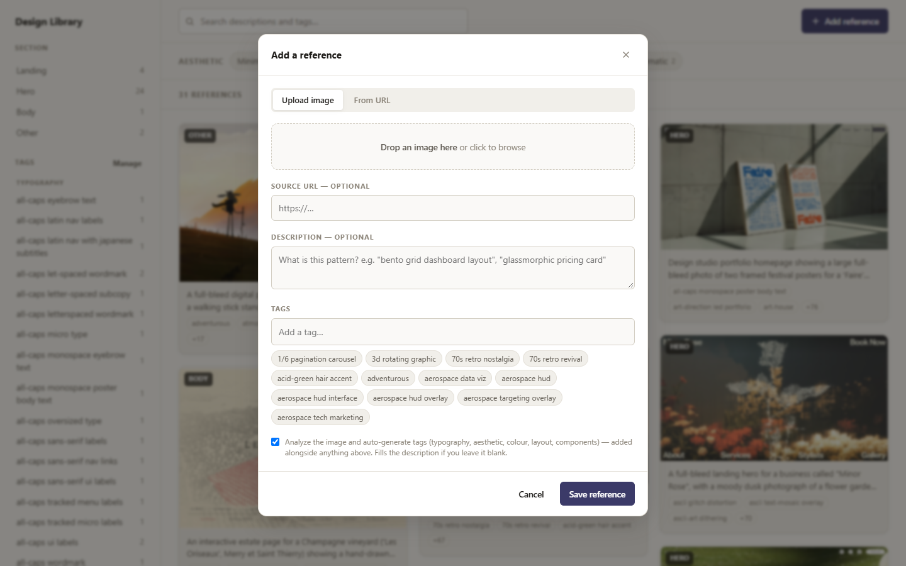
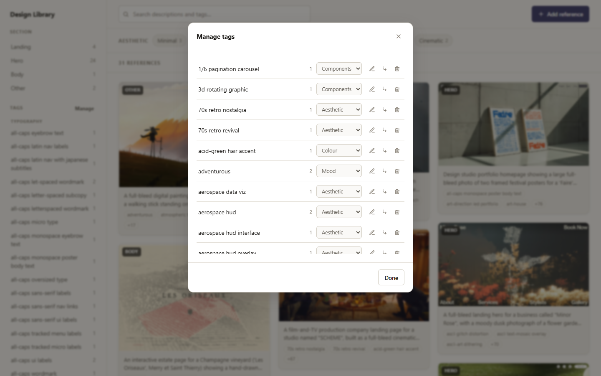

# Design Library

A personal, local, single-user web app for collecting and organizing UI/UX design
references — uploaded screenshots and links to sites/Dribbble shots — organized by
freeform **tags** with a short "what this pattern is" description on each item.
Drop in a screenshot and Claude can describe it and tag it for you (typography,
colour, layout, mood…), so you can find it later and paste the tags straight into
prompts.

The whole library (SQLite database **and** image files) lives inside this repo, so
you can push it to GitHub and `git pull` it on another machine to get the same
library.

**Live demo (read-only):** <https://design-library-theta-seven.vercel.app>



## Screenshots

| | |
|---|---|
|  |  |
| **Filter** by aesthetic, section, tags and text — filters compose and live in the URL. | **Item detail** — description, aesthetic, section, and tags grouped by subcategory. |
|  |  |
| **Add a reference** from an image or a URL, with optional AI auto-tagging. | **Manage tags** — rename, merge, re-file into a subcategory, or delete. |

## Setup

Requires **Node.js ≥ 22.5** (uses the built-in `node:sqlite` module — no native
build step).

```bash
npm install
npm start
```

Then open <http://localhost:3001>.

`npm start` builds the frontend and runs the server on one port. To change the
port: `PORT=4000 npm start`.

### Starting your own library

This repo ships with my library in `data/` as sample content. To start empty,
delete `data/library.db`, `data/library.json` and the files in `data/uploads/`
— the server recreates a fresh database on its next start.

## AI auto-tagging (optional)

When an image is uploaded, the server can analyse it with Claude vision and
attach generated tags, each filed under a **subcategory** so the library stays
organised:

| Subcategory | Examples |
|-------------|----------|
| Typography | `geometric sans-serif headings`, `serif body copy`, `monospace ui labels` |
| Aesthetic | `neubrutalism`, `glassmorphism`, `editorial`, `swiss/international` |
| Colour | `muted earth tones`, `high-contrast black on white`, `dark mode` |
| Layout | `asymmetric bento grid`, `split-screen hero`, `generous whitespace` |
| Components | `pricing table`, `logo cloud`, `email capture input` |
| Mood | `playful`, `luxury`, `understated` |
| Treatment | `soft drop shadows`, `grain texture`, `duotone photography` |

They're phrased so you can paste them straight into prompts for other projects.
The generated description fills the item's description when you leave that field
blank. Generated tags are merged with any tags you typed yourself (which stay
uncategorised); nothing is overwritten. The tag sidebar and the item view group
tags by subcategory, and **Manage tags** has a dropdown to re-file any tag
(including your manual ones) or clear its category.

The analyzer also assigns each screenshot two single-value classifications:

- **Aesthetic** — one broad style bucket: `minimal`, `editorial`, `brutalist`,
  `swiss`, `corporate`, `glassy`, `playful`, `maximalist`, `luxury`, `dark-tech`,
  `retro-futurist`, `retro-analog`, `cinematic`, or `other`. Shown as a one-click
  filter strip across the top of the gallery.
- **Section** — `landing`, `hero`, `body`, `component`, `nav`, `footer`,
  `pricing`, `dashboard`, or `other`. Filterable from the left sidebar.

Both compose with the tag and text filters and live in the URL. An item's detail
page shows and edits both, and has a **Re-analyze** button that reruns the vision
pass on demand (adds any new tags, sets the aesthetic + section, fills a
still-blank description). To classify a batch of existing references, run
`npm run backfill` (needs the server running in another terminal) — it does the
ones still missing a value; `npm run backfill -- --all` redoes everything.

There are two backends; the server picks one automatically:

1. **API** — set `ANTHROPIC_API_KEY` (copy `.env.example` to `.env`, which the
   server reads on start). One vision API call per upload, roughly a cent or two
   on the default model. `.env` is git-ignored, so the key is never committed.
2. **Claude CLI** — if there's no key but the [`claude`](https://claude.com/claude-code)
   command is installed and logged in, the server shells out to it headlessly
   (`claude -p`, restricted to its `Read` tool). No API key, no per-call billing
   — usage counts against whatever plan that CLI is signed in to. Slower
   (~15–20 s per image) since each run loads the CLI's own context.

If neither is available the upload flow works exactly as before and the
"analyse image" checkbox is hidden. Uncheck it on any single upload to skip the
call.

| Env var | Default | |
|---------|---------|---|
| `DESIGN_LIBRARY_AI_BACKEND` | `auto` | `auto` \| `api` \| `cli` \| `off` |
| `ANTHROPIC_API_KEY` | — | enables the API backend |
| `DESIGN_LIBRARY_AI_MODEL` | `claude-opus-5` (api) / CLI default | model id (api) or `opus`/`sonnet`/`haiku` (cli) |
| `DESIGN_LIBRARY_AI_EFFORT` | `low` | `low` … `max` — API backend only |

## Development

```bash
npm run dev
```

Runs the API on `:3001` and the Vite dev server on `:5173` (with hot reload,
proxying `/api` and `/uploads` to the API). Open <http://localhost:5173>.

`npm test` runs the unit tests (Node's built-in runner, no dependencies) — they
cover the pure pieces: the section/style/tag-category vocabularies and their
input coercion (`server/lib/vocab.js`), and the tag grouping used by the
sidebar and detail view (`web/src/categories.js`).

## How it stores data

| Path | What | Committed? |
|------|------|-----------|
| `data/library.db` | SQLite database (items, tags, item↔tag links) | yes |
| `data/library.json` | Text mirror of the DB, rewritten after every change | yes |
| `data/uploads/` | Uploaded images + downloaded link previews | yes |
| `node_modules/`, `web/dist/` | Regenerated by `npm install` / `npm start` | no |

### Syncing across machines

Commit and push after adding references; `git pull` on the other machine.

The SQLite file is binary, so git can't merge it if you edit the library on two
machines before syncing. If that happens, resolve the conflict in favour of either
`data/library.json` (the diffable text mirror) and rebuild the database from it:

```bash
npm run db:rebuild
```

## Deploying a read-only copy (Vercel)

The library can be published as a **read-only** site on Vercel so you can browse
it from anywhere. `vercel.json` builds the frontend, copies `data/uploads/` into
the static output, and routes `/api/*` to `api/index.js`, which wraps the same
Express app. On Vercel (detected via the `VERCEL` env var) the database is opened
read-only and any non-`GET` API request gets a `403` — Vercel's filesystem can't
persist writes, so you keep editing locally and redeploy.

```bash
npm i -g vercel
vercel deploy --prod
```

If the project is connected to the GitHub repo, every push to `main` redeploys —
so commit `data/` along with your code.

## Features

- **Add references** by uploading an image (drag-and-drop or file picker) or by
  pasting a URL — the server scrapes the page's Open Graph / Twitter metadata for a
  title and preview image. If a page blocks scraping, upload a thumbnail manually
  and the source URL is still saved.
- **Gallery** — masonry grid, newest first.
- **Filter** by one or more tags (match **Any** or **All**) from the sidebar, and
  **search** across descriptions and tag names.
- **Item detail** — full-size image, description, aesthetic, section, tags (click
  to filter), source link, date added; edit, re-analyze, or delete inline.
- **Aesthetic + Section filters** — an **Aesthetic** bucket strip across the top
  of the gallery, and a **Section** list in the left sidebar with counts. Both
  compose with tag and text filters and live in the URL.
- **Tag management** — sidebar tag list with counts, grouped by subcategory;
  rename, merge, re-file (change subcategory), and delete tags (renaming onto an
  existing tag merges into it).

## Project layout

```
api/index.js       Vercel serverless entry (re-exports the Express app)
vercel.json        Vercel build + routing for the read-only deployment
server/            Express API + SQLite access
  index.js         app entry — serves the API and the built frontend
  db.js            schema, queries, JSON snapshot/rebuild
  env.js           loads .env before anything reads process.env
  routes/          items, tags, preview
  lib/             upload (multer), scrape (link previews), analyze (Claude vision auto-tagging)
  migrations/      001 schema … 004 item aesthetic/section (tracked in schema_migrations)
  backfill.js      re-analyze existing references (npm run backfill)
web/               React + Vite frontend
  src/pages/       Gallery, ItemDetail
  src/components/  AddItemDialog, MasonryGrid, TagSidebar, SectionSidebar, TagManager, TagInput, Modal
  src/categories.js / sections.js / aesthetics.js  vocab lists (mirror server/db.js)
data/              the library (see table above)
docs/screenshots/  images used in this README
```

## API

| Method | Path | |
|--------|------|---|
| `GET` | `/api/items?tags=a,b&mode=and\|or&q=text&section=hero&style=editorial` | filtered list |
| `GET` | `/api/items/:id` | one item (includes `section`, `style`) |
| `POST` | `/api/items` | create — `multipart/form-data` with an `image`, or JSON `{ image_url, source_url?, description?, tags? }`. Add `analyze=false` to skip AI auto-tagging for that upload. |
| `PATCH` | `/api/items/:id` | update `description` / `source_url` / `section` / `style` / `tags` |
| `POST` | `/api/items/:id/reanalyze` | rerun the vision pass on the stored image |
| `DELETE` | `/api/items/:id` | delete item + its image file |
| `POST` | `/api/preview` | `{ url }` → `{ title, imageUrl, siteName }` (no persistence) |
| `GET` | `/api/tags` | tags with item counts and `category` |
| `PATCH` | `/api/tags/:id` | rename (`{ name }`) and/or re-file (`{ category }`, `null` clears) |
| `POST` | `/api/tags/:id/merge` | merge (`{ intoId }`) |
| `DELETE` | `/api/tags/:id` | delete |
| `GET` | `/api/sections` | sections in use, with item counts |
| `GET` | `/api/styles` | aesthetic buckets in use, with item counts |
| `GET` | `/api/health` | `{ ok, aiTagging }` — `aiTagging` is true when a tagging backend is available |

## Contributing

Issues and pull requests are welcome. Run `npm test` before opening a PR.

## License

The code is released under the [MIT License](LICENSE).

The images in `data/uploads/` and `docs/screenshots/` are screenshots of
third-party websites and artwork collected as design references. They remain
the property of their respective owners and are **not** covered by the MIT
License.
